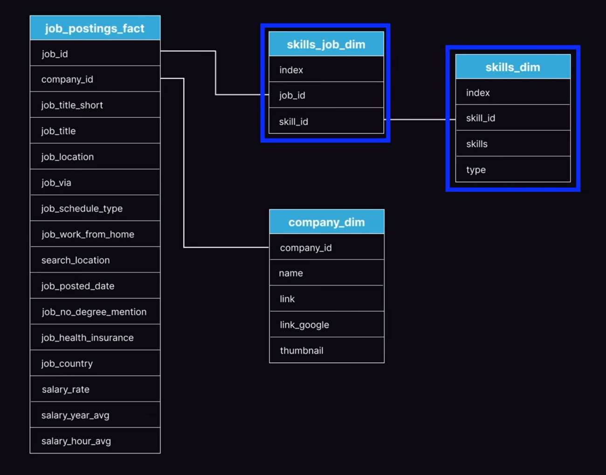

# Introduction
📊 Dive into the data job market! Focusing on data analyst roles, this project explores:
- Top paying jobs
- In demand skills
- Where high demand meets high salary in data analytics

SQL queries can be viewed here: [project_sql_folder](/sql_project/).

# Background
Driven by a request to navigate the data analyst job market more effectively, this project was born from a desire to pinpoint top-paid and in-demand skills, streamlining others work to find optimal jobs.

Data hails from [luke barouss's course](https://lukebarousse.com/sql). It's packed with insights on job titles, salaries, locations and essential skills.
## The questions I wanted to answer through my SQL queries were:
1. What are the top-paying data analyst jobs?
2. What skills are required for these top-paying jobs?
3. What skills are most in demand for data analysts?
4. Which skills are associated with higher salaries?
5. What are the most optimal skills to learn?

# Tools I Used
For answering my questions I opted to use the following tools:
- **SQL**: The backbone of my analysis, allowing me to query the given database and unearth critical insight.
- **PostreSQL**: The chosen database maanagement system, ideal for handling the job posting data.
- **Visual Studio Code**: My go-to for database management and executing SQL queries.
- **Git&GitHub**: Essential for version control and sharing my SQL scripts and analysis, ensuring collaboration and project tracking.
# The Analysis
## The Data:
The data is comprised form five tables as shown in this star schema:

 - **`job_postings_fact`**: The main table, contains info about job offerings, offering company, job title (explicit and shortened), location, place of posting, whether it is Full-time or something else, work from home, salary (where posted) and other general information.
 - **`company_dim`** : Describes the company name in relation to the company id appearing in the `job_postings_fact` table, as well as other relevant information.
 - **`skills_job_dim`**: Describes a list of the skills required by the job offering, shown by the `skill_id` column.
 - **`skills_dim`**: Relating to `skills_job_dim` Describes the name of the skill detailed by `skill_id`, name of the skill and its type.

Each query for this project aimed at investigating specific aspects of the data nalyst job market. Here's how I approached each question:
## 1. Top Paying Data Analyst Jobs
To identify the highest paying roles I filtered data analyst positions by average yearly salary and location, focusing on remote jobs. This query highlights the high paying opportunities in the field.
```sql
SELECT
    job_id,
    job_title,
    job_location,
    job_schedule_type,
    salary_year_avg,
    job_posted_date,
    name AS company_name
FROM
    job_postings_fact
LEFT JOIN company_dim ON job_postings_fact.company_id = company_dim.company_id
WHERE
    job_title_short = 'Data Analyst' AND
    job_location = 'Anywhere' AND
    salary_year_avg IS NOT NULL
ORDER BY
    salary_year_avg DESC
LIMIT 10
```
The highest-paying remote data analyst positions show considerable salary variation, ranging from $184,000 to $650,000 annually. Many of these positions involve senior, principal, or director-level responsibilities, suggesting that experience and specialization can significantly influence earning potential. The $650,000 position at Mantys stands out as an exceptional outlier.

## 2. Top Skills for Top Paying Jobs
Building from the first question answered in the first query, and by using its code as a `CTE`, I analysed what skills where required in the highest paying jobs:

```sql
WITH top_paying_jobs AS ( --job location and schedule type and job posted date aren't adding values to this query and thus are removed.
    SELECT
        job_id,
        job_title,
        salary_year_avg,
        name AS company_name
    FROM
        job_postings_fact
    LEFT JOIN company_dim ON job_postings_fact.company_id = company_dim.company_id
    WHERE
        job_title_short = 'Data Analyst' AND
        job_location = 'Anywhere' AND
        salary_year_avg IS NOT NULL
    ORDER BY
        salary_year_avg DESC
    LIMIT 10
)

SELECT 
    top_paying_jobs.*, --selects all columns from `top_paying_jobs`
    skills
FROM top_paying_jobs
INNER JOIN skills_job_dim ON top_paying_jobs.job_id = skills_job_dim.job_id
INNER JOIN skills_dim ON skills_job_dim.skill_id = skills_dim.skill_id -- two joins in order to allocate each job with every skill detailed for it (skill_dim = all skills, skill = what skills are based on id)
ORDER BY
    salary_year_avg DESC
```
Among the highest-paying data analyst positions with listed skills, `SQL` and `Python` appear frequently, alongside visualization tools such as `Tableau`. Several positions also require `cloud technologies` and `advanced analytical tools`, suggesting that highly compensated analysts often benefit from combining traditional data analysis skills with broader technical expertise.

## 3. Top Demanded Skills
Seperately from trying to show only the highest paying skills, it is also important to factor-in the most demanded skills, so as not to skew any conclusion towards niche/opportunistic skills:

```sql
SELECT
    skills,
    COUNT(skills_job_dim.job_id) AS demand_count
FROM job_postings_fact
INNER JOIN skills_job_dim ON job_postings_fact.job_id = skills_job_dim.job_id
INNER JOIN skills_dim ON skills_job_dim.skill_id = skills_dim.skill_id
WHERE
    job_title_short = 'Data Analyst'
    --  AND job_work_from_home = TRUE
GROUP BY
    skills
ORDER BY
    demand_count DESC
LIMIT 5
```
`SQL` dominates the demand for data analyst skills, appearing in 92,628 job postings, followed by `Excel` (67,031) and `Python` (57,326). `Tableau` and `Power BI` also feature prominently, highlighting the importance of data visualization. These findings suggest that `SQL`, `Excel`, `Python`, and `BI tools` form a strong foundation for aspiring data analysts.

## 4. Top Paying Skills
As a mirror to the previous question, here I analyse what skills are overall most well-compensated, even if not too popular:

```sql
SELECT
    skills,
    ROUND(AVG(salary_year_avg), 0) AS avg_salary
FROM job_postings_fact
INNER JOIN skills_job_dim ON job_postings_fact.job_id = skills_job_dim.job_id
INNER JOIN skills_dim ON skills_job_dim.skill_id = skills_dim.skill_id
WHERE
    job_title_short = 'Data Analyst'
    AND salary_year_avg IS NOT NULL
    AND job_work_from_home = TRUE
GROUP BY
    skills
ORDER BY
    avg_salary DESC
LIMIT 25
```

`PySpark` leads the salary rankings with an average annual salary of $208,172, followed by `Bitbucket` ($189,155). Several specialized technologies, including `Couchbase`, `DataRobot`, and `GitLab`, are associated with particularly high salaries. However, these figures may reflect relatively small samples or specialized senior positions rather than a direct salary premium attributable to individual skills.

## 5. Optimal Skills
Combinindg the conclusions from the two previous analyses, here I am trying to showcase the list of the optimal skills to acquire as an aspiring data analyst. These skills are both high in demand in the job market and well-compensated. As such, being proficient in these skills raises the chance of landing a job quickly and with a high salary:

```sql
WITH average_salary AS (
    SELECT
        skills_job_dim.skill_id,
        skills_dim.skills,
        ROUND(AVG(salary_year_avg), 0) AS avg_salary
    FROM job_postings_fact
    INNER JOIN skills_job_dim ON job_postings_fact.job_id = skills_job_dim.job_id
    INNER JOIN skills_dim ON skills_job_dim.skill_id = skills_dim.skill_id
    WHERE
        job_title_short = 'Data Analyst'
        AND salary_year_avg IS NOT NULL
        AND job_work_from_home = TRUE
    GROUP BY 
        skills_job_dim.skill_id,
        skills_dim.skills
    ORDER BY
        avg_salary DESC
), skills_demand AS (
    SELECT
        skills_job_dim.skill_id,
        skills_dim.skills,
        COUNT(skills_job_dim.job_id) AS demand_count
    FROM job_postings_fact
    INNER JOIN skills_job_dim ON job_postings_fact.job_id = skills_job_dim.job_id
    INNER JOIN skills_dim ON skills_job_dim.skill_id = skills_dim.skill_id
    WHERE
        job_title_short = 'Data Analyst'
        AND job_work_from_home = TRUE
        AND salary_year_avg IS NOT NULL
    GROUP BY 
        skills_job_dim.skill_id,
        skills_dim.skills
    ORDER BY
        demand_count DESC
)

SELECT 
    skills_demand.skill_id,
    skills_demand.skills,
    demand_count,
    avg_salary
FROM 
    skills_demand
INNER JOIN
    average_salary ON skills_demand.skill_id = average_salary.skill_id
ORDER BY
    demand_count DESC,
    avg_salary DESC
LIMIT 25
```
`SQL` remains the most frequently requested skill, appearing in 398 postings, followed by `Excel` (256) and `Python` (236). However, less frequently requested technologies such as `Snowflake` ($112,948), `Azure` ($111,225), and `Go` ($115,320) are associated with higher average salaries. This suggests a potential distinction between foundational skills that maximize employment opportunities and specialized skills associated with higher compensation.

# What I learned
Throughout this project, I've turbocharged my SQL toolkit with some serious firepower:
-  **Complex Query Crafting:** Mastered the art of advanced SQL, merging tables and using CTEs with the `WITH` clause to create temp tables.
- **Data Aggregation:** Strenghening my foundations with using clauses such as `GROUP BY` and the relevant aggregation functions such as `COUNT()` and `AVG()`.
- **Analytical Skills:** Improved my real-world puzzle-solving skills, turning questions into actionable, insightful SQL queries that allowed me to shed light on the data and come up with an answer.

# Conclusion

## Insights
Across the five queries, `SQL`, `Python`, `Excel`, and `visualization tools` consistently emerge as essential skills for data analysts. Meanwhile, `cloud computing`, `data engineering`, and `specialized technologies` appear more frequently among higher-paying positions. For someone entering the field, developing strong foundational analytical skills before pursuing technical specialization appears to be a sensible career strategy.

## Closing Thoughts
This project really improved my SQL skills, as well as strengthening my capabilities working with adjacent tools such as PostgreSQL, VS-Code, GIT, and understanding data structures such as star-schemas and the logic behind data architecture.
I learned several useful clauses, how to use them, applied them to solve problems and answer questions, and produced relevant insights from the data. For the future I hope I can better deepen and improve my knowledge of SQL, its tool-sphere, data, and related skills such as python, excel, and data visualization tools.

Thank you for reading!